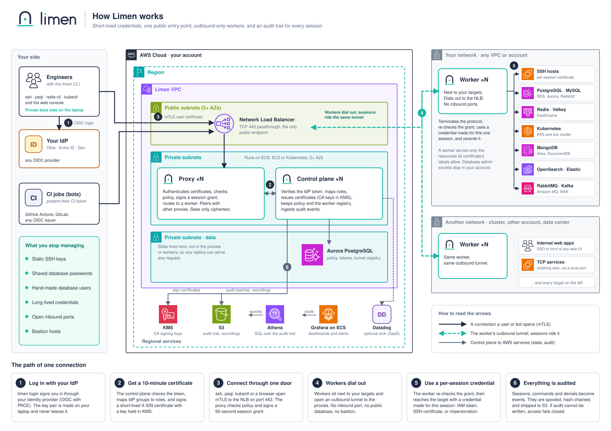

<p align="center">
  <picture>
    <source media="(prefers-color-scheme: dark)" srcset="assets/logo-dark.svg">
    
  </picture>
</p>

<p align="center"><b>Identity-aware access to your infrastructure. Short-lived, audited, self-hosted.</b></p>

<p align="center">
  <a href="https://github.com/limen-dev/limen/actions/workflows/ci-rust.yml"></a>
  <a href="LICENSE"></a>
  
  <a href="https://github.com/limen-dev/limen/milestones"></a>
</p>

<p align="center">
  <a href="#try-it-on-your-laptop">Try it</a> ·
  <a href="#how-it-works">How it works</a> ·
  <a href="#what-it-connects-to">What it connects to</a> ·
  <a href="#what-is-not-verified-yet">What is not verified yet</a> ·
  <a href="#documentation">Docs</a>
</p>

# Limen

Limen decides who can reach your servers, databases and clusters, and keeps a record of what they did there.

Engineers sign in through your company's identity provider. Limen checks a policy you keep in Git, then gives them a certificate that **expires in an hour** (or sooner: you choose per role). They connect with the tools they already use (`ssh`, `psql`, `kubectl`, `redis-cli`), and every session is recorded or audited into a **signed trail you can verify yourself**. CI jobs sign in the same way, with their own short-lived token, so your pipelines hold no long-lived secret either.

It is open source (Apache-2.0), written in Rust, and you run it on your own infrastructure. It is not production-ready yet: there is no release, and nothing has been tried against real cloud services. [What is not verified yet](#what-is-not-verified-yet) has the details.

## Why you might want it

Keys, passwords and tokens tend to outlive the reason they were handed out. Limen is built so that no person or pipeline holds one for long, and so that you can always answer two questions: who can get in right now, and what did they do?

| | Without it | With Limen |
|---|---|---|
| **Getting onto a server** | An SSH key that stays valid until someone removes it | A certificate that expires in an hour, or sooner if you choose |
| **Getting into a database** | A password that people copy and share | `limen db connect orders-prod`. Only Limen's worker holds the database credential; no person sees it |
| **Someone leaves the team** | Find and remove every key and password they had | Disable them in your identity provider and they can't start new sessions. `limen admin lock` also ends their open ones within seconds |
| **A CI job deploys** | A long-lived secret stored in the CI settings | The job's own OIDC token becomes a short, scoped login |
| **The network** | Targets reachable from a bastion or a VPN | Limen's worker dials out from your network, so targets need no inbound port |
| **"Who ran that `DELETE`?"** | Depends on what the database logs, and for how long | Every statement, tied to the person or CI job that ran it, in a hash-chained trail |

## What using it looks like

```sh
$ limen login --proxy limen.example.com:443   # a browser opens on your identity provider
$ limen ls                                    # what am I allowed to reach?
NAME             KIND        ACCESS AS                LABELS
bastion-staging  ● ssh       ec2-user, ubuntu         env=staging tier=bastion
orders-staging   ● postgres  limen_read, limen_write  env=staging team=payments
web-staging-1    ● ssh       ec2-user, ubuntu         env=staging
  3 resources · `limen show <name>` tells you how to connect to one

$ limen ssh web-staging-1                     # a recorded SSH session
$ limen db connect orders-staging             # a local address for psql, no password needed
$ limen explain orders-prod                   # why can't I reach this one?
$ limen request orders-prod --for 30m --reason "INC-123: orders table is locked"
```

If a resource isn't in your list, `limen explain` tells you which rule stopped you, and `limen request` asks an approver for time-limited access.

## Try it on your laptop

There is no release to download yet, so this builds Limen from source and runs the whole system on your machine, with a test identity provider and test users. You need Docker (on macOS, OrbStack or Docker Desktop) and the tools pinned in `mise.toml` (run `mise install`). The first build takes several minutes.

```sh
git clone https://github.com/limen-dev/limen && cd limen

# 1. Start everything. The script checks your tools, asks what to enable (an SSH host,
#    databases, Redis, Kubernetes, observability...), applies an example policy, and
#    prints a ready-to-run command for each resource.
deploy/compose/setup.sh

# 2. Install the CLI (re-run after pulling to upgrade)
scripts/install-cli.sh

# 3. Sign in. A browser opens; use admin@example.com with the password "password".
limen --proxy localhost:3443 login --ca-file deploy/compose/.state/internal-ca.pem

# 4. Connect
limen ls
limen ssh web-staging-1

# 5. Open the web console, sign in as the same user, and replay the session you just had
open https://localhost:3443/console/        # on Linux, paste the address into a browser
```

> [!NOTE]
> Your browser will warn about the console's certificate. That is expected: it comes from a development CA the script just created. Click through the warning on localhost. **Don't** add that CA to your system's trust store. The other test users, and what each one is allowed to see, are listed in [`deploy/compose/README.md`](deploy/compose/README.md).

The [quickstart](website/src/content/docs/docs/quickstart.md) walks through the same steps with more explanation.

## How it works

[](docs/diagrams/README.md)

Limen is three programs:

- **The control plane** signs people and bots in through your identity provider, issues their short-lived certificates, keeps the policy, and writes the audit trail. The only database it needs is PostgreSQL.
- **The proxy** is the one public entry point. It checks each connection against the policy and passes it to the right worker.
- **The worker** runs inside your network, next to the things you want to reach. It dials *out* to the proxy, so nothing on your side needs an open inbound port. It speaks each target's protocol, records or audits the session, and signs in to the target with credentials only it holds.

All three are static binaries. If Limen can't write the audit trail, it refuses new sessions rather than let them run unrecorded.

The [diagrams page](docs/diagrams/README.md) follows one connection step by step, and shows where credentials and audit events go when parts of the system fail.

## What it connects to

Each target works with ordinary self-hosted servers and with the managed services listed under it. **✅** means built and tested against a local copy of that software. **⚠️** names the managed-service parts that have not been tried for real yet.

<table>
  <tr>
    <td align="center" valign="top" width="25%"><br><br><br><b>SSH</b><br><sub>Amazon EC2 and any SSH host<br>a certificate per session, recorded and replayable</sub><br><br><sub>✅ tested locally</sub><br><br></td>
    <td align="center" valign="top" width="25%"><br><br><br><b>PostgreSQL</b><br><sub>RDS · Aurora · Redshift<br>every statement audited</sub><br><br><sub>✅ tested locally<br>⚠️ RDS IAM and Redshift</sub><br><br></td>
    <td align="center" valign="top" width="25%"><br><br><br><b>MySQL</b><br><sub>RDS · Aurora<br>every statement audited</sub><br><br><sub>✅ tested locally<br>⚠️ RDS IAM</sub><br><br></td>
    <td align="center" valign="top" width="25%"><br><br><br><b>Redis and Valkey</b><br><sub>ElastiCache<br>commands audited, values redacted</sub><br><br><sub>✅ tested locally<br>⚠️ ElastiCache IAM</sub><br><br></td>
  </tr>
  <tr>
    <td align="center" valign="top" width="25%"><br><br><br><b>Kubernetes</b><br><sub>Amazon EKS and any cluster<br>impersonation, recorded <code>exec</code></sub><br><br><sub>✅ tested on kind<br>⚠️ EKS</sub><br><br></td>
    <td align="center" valign="top" width="25%"><br><br><br><b>MongoDB</b><br><sub>Atlas · DocumentDB<br>commands audited, values redacted</sub><br><br><sub>✅ tested locally<br>⚠️ Atlas, DocumentDB, AWS IAM</sub><br><br></td>
    <td align="center" valign="top" width="25%"><br><br><br><b>OpenSearch</b><br><sub>Amazon OpenSearch Service<br>policy by index pattern</sub><br><br><sub>✅ tested locally<br>⚠️ the AWS service</sub><br><br></td>
    <td align="center" valign="top" width="25%"><br><picture><source media="(prefers-color-scheme: dark)" srcset="https://cdn.simpleicons.org/elasticsearch/white"></picture><br><br><b>Elasticsearch</b><br><sub>self-hosted and Elastic Cloud<br>policy by index pattern</sub><br><br><sub>✅ tested locally<br>⚠️ Elastic Cloud</sub><br><br></td>
  </tr>
  <tr>
    <td align="center" valign="top" width="25%"><br><br><br><b>RabbitMQ</b><br><sub>Amazon MQ<br>message bodies never audited</sub><br><br><sub>✅ tested locally<br>⚠️ Amazon MQ</sub><br><br></td>
    <td align="center" valign="top" width="25%"><br><picture><source media="(prefers-color-scheme: dark)" srcset="https://cdn.simpleicons.org/apachekafka/white"></picture><br><br><b>Kafka</b><br><sub>Amazon MSK<br>record values never audited</sub><br><br><sub>✅ tested locally<br>⚠️ MSK and its IAM sign-in</sub><br><br></td>
    <td align="center" valign="top" width="25%"><br><br><br><b>Internal web apps</b><br><sub>single sign-on in front of any web UI<br>every request audited</sub><br><br><sub>✅ tested locally</sub><br><br></td>
    <td align="center" valign="top" width="25%"><br><br><br><b>Anything else over TCP</b><br><sub>through a port on your machine<br>same policy, same audit</sub><br><br><sub>✅ tested locally</sub><br><br></td>
  </tr>
</table>

## Who can sign in

<table>
  <tr>
    <td align="center" valign="top" width="25%"><br><br><br><b>Any OIDC provider</b><br><sub>Okta, Entra ID, Keycloak, Auth0, Dex<br>your groups map to Limen roles</sub><br><br><sub>✅ tested with Dex<br>⚠️ Okta and the others</sub><br><br></td>
    <td align="center" valign="top" width="25%"><br><br><br><b>GitHub Actions</b><br><sub>the job's OIDC token<br>becomes a bot login</sub><br><br><sub>✅ tested with a stand-in issuer<br>⚠️ real GitHub tokens</sub><br><br></td>
    <td align="center" valign="top" width="25%"><br><br><br><b>GitLab CI</b><br><sub>the job's ID token<br>becomes a bot login</sub><br><br><sub>✅ tested with a stand-in issuer<br>⚠️ real GitLab tokens</sub><br><br></td>
    <td align="center" valign="top" width="25%"><br><br><br><b>Other automation</b><br><sub>any OIDC token, including<br>Kubernetes service accounts</sub><br><br><sub>✅ tested with a stand-in issuer<br>⏳ AWS IAM: <a href="https://github.com/limen-dev/limen/milestone/16">Phase 15</a></sub><br><br></td>
  </tr>
</table>

A bot is matched on exact claims of its token (for example the repository and the branch), gets a short-lived certificate (15 minutes by default, at most an hour), and is bound by the same policy. The CI run that made each request is written into every audit event.

## Audit and monitoring

<table>
  <tr>
    <td align="center" valign="top" width="25%"><br><br><br><b>S3, signed and chained</b><br><sub>batches signed and linked by hash<br>checked by <code>limen-audit-verify</code></sub><br><br><sub>✅ tested with a local S3<br>⚠️ Amazon S3</sub><br><br></td>
    <td align="center" valign="top" width="25%"><br><picture><source media="(prefers-color-scheme: dark)" srcset="https://cdn.simpleicons.org/datadog/white"></picture><br><br><b>Datadog</b><br><sub>logs, plus monitors<br>as Terraform</sub><br><br><sub>✅ tested with a fake intake<br>⚠️ real Datadog</sub><br><br></td>
    <td align="center" valign="top" width="25%"><br><br><br><b>Grafana</b><br><sub>optional dashboards<br>over S3 and Athena</sub><br><br><sub>✅ tested with Trino<br>⚠️ Athena</sub><br><br></td>
    <td align="center" valign="top" width="25%"><br><br><br><b>Metrics and traces</b><br><sub>Prometheus <code>/metrics</code>, OpenTelemetry traces,<br>example alerts</sub><br><br><sub>✅ tested locally</sub><br><br></td>
  </tr>
</table>

Audit events are written to S3 in signed batches, and each batch records the hash of the one before it, like links in a chain. If a batch goes missing, is reordered, or is edited, one command finds it:

```sh
limen-audit-verify --bucket <your-audit-bucket> --ca-file internal-ca.pem
```

Traces carry only ids and outcomes, never user names, SQL statements or tokens. To see one locally, start the dev stack with Jaeger: `deploy/compose/setup.sh --yes --stacks ssh,tracing`.

## The console and the CLI

<table>
  <tr>
    <td width="50%" valign="top">
      <h3>Web console</h3>
      <ul>
        <li><b>Resources:</b> everything Limen can reach, who has access, and whether a worker is serving it</li>
        <li><b>Sessions:</b> live and past, with SSH sessions you can <b>replay</b> or <b>watch live</b> in the browser, and a button to <b>end a session</b></li>
        <li><b>Access:</b> ask for access, and approve or deny requests, seeing what the person did on that resource in the past 30 days</li>
        <li><b>Audit:</b> search every event, and jump from a statement to the moment in the recording</li>
        <li><b>Reviews:</b> keep or remove each person's access, and download a <b>signed evidence pack</b></li>
        <li><b>Users, bots and workers:</b> <b>lock</b> a user with a reason, issue <b>join tokens</b>, <b>revoke</b> a worker</li>
        <li><b>Policy:</b> the active policy, and a <b>preview of what changes</b> before you apply a new one</li>
        <li>Everyone except admins and auditors sees only their own resources and sessions</li>
      </ul>
    </td>
    <td width="50%" valign="top">
      <h3>Command line</h3>
      <ul>
        <li><b><code>limen login</code></b> through your identity provider, in a browser or with <code>--device</code>; <b><code>limen status</code></b> shows who you are and the time left</li>
        <li><b><code>limen ls</code></b> shows what you can reach, as a table or as JSON; <b><code>limen show &lt;name&gt;</code></b> says how to connect to one</li>
        <li><b><code>limen ssh</code></b>, <b><code>limen db connect</code></b>, <b><code>limen kube login</code></b> and the rest, one per protocol, or <b><code>limen connect &lt;name&gt;</code></b> to pick for you</li>
        <li><b><code>limen config ssh</code></b> lets plain <code>ssh</code> work through Limen</li>
        <li><b><code>limen explain</code></b> says why you can or can't reach something</li>
        <li><b><code>limen request</code></b> asks for time-limited access; <b><code>limen approve</code></b> and <b><code>deny</code></b> answer one</li>
        <li><b><code>limen policy test</code></b>, <b><code>who-can</code></b> and <b><code>diff</code></b> question a policy before it ships</li>
        <li><b><code>limen admin</code></b> applies policy, locks users, ends sessions and manages workers</li>
      </ul>
    </td>
  </tr>
</table>

## Where it runs

| | Status |
|---|---|
| **Docker Compose**, the full stack on one machine | ✅ works; this is the local dev stack |
| **Kubernetes**, several copies of each program | ✅ example manifests; ⚠️ not yet run on a real cluster |
| **Terraform** for the audit store (S3, Glue, Athena) and the Datadog monitors | ✅ works |
| **Amazon ECS and EC2**, and a Helm chart | ⏳ planned, [Phase 15](https://github.com/limen-dev/limen/milestone/16) |

## What is not verified yet

Limen is tested thoroughly, but only against local stand-ins: [Dex](https://dexidp.io) in place of a real identity provider, databases and brokers in containers, a local S3 and KMS, and a fake Datadog intake. **Nothing has been verified against real AWS, Okta or Datadog yet.** The ⚠️ marks above say exactly which paths that affects, and each one has an issue in the [real-environment verification milestone](https://github.com/limen-dev/limen/milestone/21).

Production hardening (a Helm chart, cloud deployment modules, a penetration test) comes after the next phase, and there is no tagged release yet. Until both are done, treat Limen as something to evaluate, not something to put in front of production systems.

## Roadmap

Phases 0 to 13 are done: login and tunnels, SSH with recording, the audit pipeline, the console, bots, scale-out, the database, cache, Kubernetes, search and messaging protocols, internal web apps, and access workflows (requests and break-glass, audit search, discovery, policy tooling, access reviews, and watching a live session).

Next:

- **Phase 14, one management API (in progress):** manage roles, resources, and bots from the CLI, the console, or Terraform, with one owner per document and scoped writers for automation ([ADR-0042](docs/adr/0042-management-api.md), [milestone](https://github.com/limen-dev/limen/milestone/23))
- **Phase 15, production readiness:** a Helm chart, ECS and EC2 modules, and a penetration test ([milestone](https://github.com/limen-dev/limen/milestone/16))
- **Verification against real services** ([milestone](https://github.com/limen-dev/limen/milestone/21))
- **The documentation site**, already built in [`website/`](website/), is published when the repository goes public ([milestone](https://github.com/limen-dev/limen/milestone/8))

Every phase is a [GitHub milestone](https://github.com/limen-dev/limen/milestones) with its checklist in an epic issue. What "done" means for each one is in [`docs/design.md` §13](docs/design.md#13-phases-and-exit-criteria).

## Documentation

**Start here**
- [Quickstart](website/src/content/docs/docs/quickstart.md) and [concepts](website/src/content/docs/docs/concepts.md): run it, then understand what happened
- [What is built and what is verified](website/src/content/docs/docs/status.mdx), item by item

**Connect**
- [The CLI](docs/guides/cli.md) · [databases](docs/guides/databases.md) · [Redis](docs/guides/redis.md) · [MongoDB](docs/guides/mongodb.md) · [search](docs/guides/search.md) · [messaging](docs/guides/messaging.md) · [Kubernetes](docs/guides/kubernetes.md) · [web apps](docs/guides/web-apps.md) · [TCP](docs/guides/tcp.md)

**Control access**
- [Policy reference](docs/policy.md) · [testing and questioning policy](docs/guides/policy-tooling.md) · [access requests and break-glass](docs/guides/access-requests.md) · [access reviews](docs/guides/access-reviews.md) · [bots for CI](docs/guides/bots.md) · [the management API (Terraform)](docs/guides/management-api.md) · [resource discovery](docs/guides/discovery.md)

**Audit and operate**
- [The console](docs/guides/console.md) · [audit search](docs/guides/audit-search.md) · [watching a live session](docs/guides/watching-sessions.md) · [metrics and alerts](docs/guides/metrics.md) · [tracing](docs/guides/tracing.md) · [scale-out](docs/guides/scale-out.md) · [runbooks](docs/runbooks/README.md)

**How it is built**
- [The three programs](docs/components.md) · [design](docs/design.md) · [diagrams](docs/diagrams/README.md) · [decision records (ADRs)](docs/adr/README.md) · [threat model](docs/threat-model.md) · [penetration test plan](docs/pentest-plan.md)

## Why "Limen"

*Limen* is Latin for "threshold", the root of the English word *liminal*. A threshold is where you stop until you're allowed in. That is the job: you prove who you are, Limen lets you across for a short, recorded visit, and the door closes behind you.

It's also short enough to type all day (`limen login`, `limen ssh`). Say it "LIE-men" or "LEE-men"; both are common.

## Security

Found a vulnerability? Please report it privately through GitHub, not in a public issue. [SECURITY.md](SECURITY.md) explains how, and what is in scope.

## Contributing

[CONTRIBUTING.md](CONTRIBUTING.md) covers the repository layout, how to build and test, and the conventions. Coding agents should read [AGENTS.md](AGENTS.md).

## License

[Apache-2.0](LICENSE). Icons are from [Simple Icons](https://simpleicons.org) (CC0) and [Lucide](https://lucide.dev) (ISC). Product names and logos belong to their owners and appear here only to say what Limen works with.
