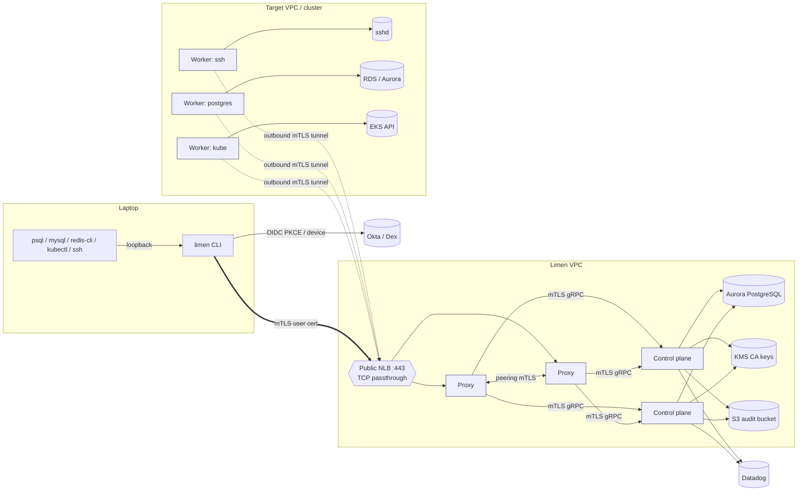

<p align="center"><picture><source media="(prefers-color-scheme: dark)" srcset="../assets/logo-dark.svg"></picture></p>

# Limen design

Status: **Accepted (Phase 0, approved 2026-10-13)**. Last updated 2026-10-25 (Phase 13 built). Phase status is in §13 only.

Limen is a self-hosted, open-source platform for identity-aware access to infrastructure. Engineers log in through their identity provider (IdP). In return they get short-lived, audited access to SSH hosts, RDS and Aurora databases, ElastiCache Redis, and EKS clusters. No static SSH keys, shared database passwords, or hand-made users are involved.

Each key decision has its own ADR in [`docs/adr/`](adr/). Threats and mitigations are in [`threat-model.md`](threat-model.md).

---

## 1. Goals and non-goals

**Goals (v1)**
- Log in with OIDC (Okta first) and turn IdP groups into roles. Credentials last 10 minutes by default.
- Access, end to end: SSH (EC2 and any SSH host), RDS PostgreSQL and MySQL, Aurora (both engines), ElastiCache for Redis and Valkey (and self-managed servers), and EKS.
- Policy as YAML, deny by default, with resources selected by label.
- Audit everything: a versioned JSON event schema, delivered at least once to S3 and Datadog, with Grafana over Athena.
- Workers connect outbound only. No inbound ports into private networks.
- High availability for the control plane and proxy, with defined behavior when the control plane is down.

**Non-goals (v1):** RDP, multi-tenancy, SAML, SCIM, and multi-region.

**Design target:** about 500 users, 5,000 resources, and 500 concurrent sessions. The larger-scale path is noted where it matters.

## 2. Components



| Component | Runs where | Responsibilities | Holds |
|---|---|---|---|
| **Control plane** (`limen-control-plane`) | Limen VPC, private subnets, ≥2 replicas across AZs | API, OIDC token verification, group-to-role mapping, policy store, CA (signs with KMS), worker registry, enrollment, tunnel registry, audit ingestion and shipping | Aurora credentials, `kms:Sign` on CA keys, S3 write |
| **Proxy** (`limen-proxy`) | Limen VPC, public NLB, ≥2 replicas across AZs | The only public entry point. Terminates TLS, authenticates user certs, makes the authorization decision, issues signed session grants, routes sessions to workers (directly or through a peer proxy), emits session lifecycle events | Its own mTLS identity and a cached policy snapshot. **No** CA keys, DB access, or target credentials |
| **Worker** (`limen-worker`) | Inside target VPCs and clusters, ≥2 per resource group | Dials proxies outbound. Terminates resource protocols, re-checks grants, gets upstream credentials (RDS and ElastiCache IAM tokens, kube impersonation, per-session SSH certs), parses and audits statements and commands, records sessions, bootstraps DB roles | Its own mTLS identity and the IAM role for its targets. Reads the DB admin secret only during bootstrap |
| **CLI** (`limen`) | User machines | Login (PKCE or device code), key generation, credential storage, local listeners, kubeconfig exec plugin | User private keys (never sent anywhere) and short-lived certs |

**Deviation from the brief, flagged (ADR-0002).** The brief says the proxy records sessions. In this design the **worker** terminates protocols and records, and the proxy authenticates, authorizes, and routes. The reasons:
1. IAM DB and Redis tokens can only be minted where the AWS credentials live, which is the worker in the target account and VPC.
2. The internet-facing proxy never sees plaintext session content.
3. The protocol code runs next to the target.

The proxy still owns session start and end and the authorization decision.

## 3. Network and ingress (ADR-0005)

- **One public endpoint.** An NLB on TCP 443 passes traffic straight through to the proxies. Proxies route by TLS ALPN (`limen-tunnel/1`, `limen-peer/1`, `limen-db/1`, `limen-redis/1`, `limen-search/1`, `limen-ssh/1`, `h2` and `http/1.1`). HTTP traffic is then routed by path: `/v1/...` is the CLI API, which is relayed to the control plane, and `/k8s/<cluster>/...` is the Kubernetes API. Path routing for kube avoids wildcard certificates. kubectl supports a server URL with a path prefix.
- The **control plane is private**. Only proxies (and admins over a bastion or VPN) reach it. Workers and the CLI talk to it through the proxy. The proxy **forwards the client's verified certificate** and the control plane **verifies it again** itself. That way a compromised proxy can't make up identities. The residual risk is replaying a cert it observed, which is bounded by the cert's 10-minute TTL (see the threat model).
- **The proxy's public certificate** is publicly trusted. Options are ACM exportable public certificates or an operator-supplied cert in Secrets Manager; *this is an assumption to verify in Phase 14*. In dev, the CLI is pointed at the Limen CA with `--ca-file`. Every other TLS hop uses the Limen internal CA with mTLS.
- **Workers need egress only**, to the proxy NLB on port 443. They don't need any route to the control plane, S3, or Datadog. Audit data and recordings go through the proxy to the control plane.

## 4. Identity and credentials (ADR-0006, ADR-0007)

### 4.1 Login
1. `limen login` generates an ECDSA P-256 key pair locally: one key for X.509 and one for SSH.
2. **PKCE flow (default).** The CLI opens the browser to the IdP with `redirect_uri=http://127.0.0.1:<random>/callback`. It sets `nonce = base64url(SHA-256(x509_pubkey ‖ ssh_pubkey ‖ random))`. The CLI exchanges the code with the IdP directly as a public client.
   **Device flow** (`--device`) works the same way, with RFC 8628 polling instead of the browser redirect.
3. The CLI sends `{id_token, public keys, nonce preimage}` to the control plane through the proxy. The control plane:
   - checks the ID token against the IdP's JWKS: issuer, audience, expiry, and `nonce`
   - checks that the nonce binds exactly these public keys, so a relaying proxy can't swap in its own keys
   - maps groups to roles
   - emits `auth.login`, or `auth.denied` on failure
4. The control plane returns:
   - an **X.509 client cert** (user CA, TTL 10 min by default, configurable per role up to a cluster-wide maximum). Subject = username. The identity is carried as URI SANs: `limen://user/<name>`, one `limen://role/<role>` per role, and `limen://login/<uuid>` (ADR-0006, amended). Component certificates carry `limen://component/<kind>/<id>`.
   - the CA bundle, and the public key of the **SSH host CA**, which the CLI writes to its own known_hosts as `@cert-authority * <key>`
   - *Amended in Phase 2:* no SSH certificate is issued at login. A login certificate trusted by targets would let its holder SSH straight to any reachable host, bypassing the proxy, recording, and audit. SSH certificates are issued per session instead (§5.1).
5. Credentials are stored in `~/.limen/<proxy>/` with mode 0600. The **refresh token is not stored by default**: re-login is cheap with an active IdP session. Making this optional (encrypted in the OS keychain) is a Phase 14 decision.

`limen logout` ends the login and deletes the local credentials. It calls `Auth.Logout`, which records the login id (the one in the certificate) in `login_revocations` and emits `auth.logout`. The id is kept until the certificate expires and travels to proxies and workers in the signed policy snapshot (`revoked_logins`, like locks and kills), so within one refresh they refuse the certificate for new sessions and requests and end the login's open sessions. The user's other logins are untouched. If the proxy can't be reached the CLI deletes the local credentials anyway and says the certificate stays valid until it expires (short TTLs still bound that). The control plane's own API (including the Admin API) does not yet check revoked logins, as it does not check locks; closing that is future work. A `lock` ends all of a user's sessions.

### 4.2 Service identity, enrollment, and rotation
- An admin creates a **join token** (`limen admin token create --kind worker --label k=v`). It is single use, has a TTL (default 15 min), and only its SHA-256 hash is stored in Aurora. It is bound to the component kind, labels, and (for proxies) DNS names. Static and AWS IAM join methods are covered in ADR-0016.
- **Names (Phase 5).** A token may also approve a display name: exact, or a pattern with one `*` (`--name 'prod-a-*'`; static tokens: `limen.io/name=<pattern>`, patterns only). The component asks for one at first enrollment (`--name` / `LIMEN_NAME`); a single-use token's exact name is given without asking. The control plane validates it (`[a-z0-9-]`, 1 to 63, no leading or trailing `-`), refuses one the token doesn't approve (`permission_denied`, `auth.denied`), and keeps names unique among unrevoked components with a partial unique index; the name claim and the token's consumption share one transaction, so a conflict (`already_exists`) leaves the token unused. The name is certified as the label `limen.io/name` and kept on renewal. It is for display (console, audit `worker_name` / `proxy_name` / `component_name`, logs, `/tunnels`): the id remains the identity for certificates, policy, revocation, and audit attribution. Policy never decides on a name: a `worker_selector` on `limen.io/name` is refused when the policy is loaded (and ignored by the matcher), because whoever holds a pattern token chooses the value. A conflict on a live name is audited like any other refused enrollment (`auth.denied`, reason `name already in use`).
- The worker generates its key locally and sends `EnrollWorker{join_token, CSR}` (TLS with server authentication only, relayed by the proxy). The control plane consumes the token atomically (`UPDATE ... WHERE used_at IS NULL RETURNING`) and issues a worker cert from the internal CA, valid for 24 hours. It emits `worker.enroll`.
- Rotation: a service cert is renewed at 50% of its lifetime, so a control plane outage of 12 hours or less doesn't break workers. During **CA rotation**, the old and new CA are trusted at the same time for at least the longest cert TTL (ADR-0007).

### 4.3 CA keys
There are four keys, one per purpose: the internal mTLS CA, the user X.509 CA, the SSH user CA (trusted by targets), and the SSH host CA (trusted by the CLI). In production each is a KMS `ECC_NIST_P256` / `SIGN_VERIFY` key, with `kms:Sign` granted only to the control plane task role. KMS returns DER ECDSA signatures. X.509 uses DER directly. For OpenSSH, Limen converts DER to the `ecdsa-sha2-nistp256` signature blob (two mpints: r and s). In dev, a file-backed signer behind the same `Signer` trait is used.

## 5. Session flows

Every session follows the same skeleton:

1. The CLI connects to the proxy over mTLS with the user cert, using the right ALPN. It sends a `SessionRequest`: resource name, requested login/DB role/database, and client metadata.
2. The proxy checks that the user cert is valid, evaluates policy (its cached signed snapshot, §7.3), and on deny emits `auth.denied` and closes.
3. On allow, the proxy builds a **session grant**: session ID (UUIDv7), user, matched roles, resource, the upstream principal that policy chose (Unix login, DB role, Redis user, kube groups), expiry ≤ user cert expiry, and a nonce. It signs the grant with its own key and emits `session.start`.
4. The proxy finds a healthy worker serving that resource, using the tunnel registry (§6). It opens `WorkerTunnel.OpenSession` either on the local tunnel or through a peer proxy. Among the eligible workers it takes the less loaded of two picked at random (power of two choices on `active/max`): each worker reports `active_sessions` and `max_sessions` (`--max-sessions`, default 200, 0 for no cap) in its ping reply, the proxy adds the sessions it opened since, and peers see the load in the registry. Full workers are skipped; a worker that reports 0/0 (older than Phase 5, or uncapped) counts as half loaded and is never full. If every eligible worker is full, the user gets a `no capacity` error and the proxy emits `auth.denied` with `data.reason = "capacity"`. The worker enforces its cap itself too (`resource_exhausted`).
5. The worker verifies:
   - the grant signature: the proxy's cert chains to the internal CA and carries the proxy role
   - grant expiry, plus nonce replay (an LRU cache)
   - the forwarded user cert chain
   - its own policy decision from its own snapshot (**defense in depth: both must allow**)

   It then gets upstream credentials and bridges the session.
6. When the session ends for any reason, the worker emits its protocol events, the recording goes to the audit pipeline, and the proxy emits `session.end`. That event includes the duration, bytes in and out, and the end reason.

**Session lifetime vs. cert TTL.** An established session can outlive the 10-minute cert, as with Teleport. A per-role `max_session_ttl` (default 8 hours) caps it, and the session ends early if the user is locked out (an extension point).

### 5.1 SSH (Phase 2, implemented)
```
ssh ─ProxyCommand─ limen ssh-proxy ─mTLS(limen-ssh/1)─ proxy ─tunnel─ worker: SSH server ═ bridge ═ SSH client ─ target sshd
```
- `limen ssh [login@]resource [command]` runs the system OpenSSH client with `limen ssh-proxy` as its `ProxyCommand`, the profile's known_hosts, and no user keys or agent offered. `limen config ssh` prints the same settings as an `~/.ssh/config` block for `ssh <login>@<resource>.limen`. If the login is omitted and policy allows exactly one, that one is used.
- `ssh-proxy` opens TLS to the proxy with the user's certificate and sends a `SessionRequest{resource, login}`. The proxy decides from its policy snapshot, picks a worker (or a peer proxy, §6), signs a grant, and answers `ok` once the worker accepts. From then on the stream carries SSH **end to end between OpenSSH and the worker**, so the proxy only sees ciphertext.
- **Worker admission.** It verifies the grant (§5), checks its own snapshot and that its certified labels may serve the resource, and refuses resources without a pinned `host_key`. It then generates two Ed25519 keys for this session only and asks the control plane, through the proxy, for:
  - a **user certificate** from the SSH user CA: the granted login as the only principal, valid for 1 minute plus 1 minute of back-dating, key ID `limen:<session>:<user>`, and only `permit-pty`
  - a **host certificate** from the SSH host CA for `<resource>` and `<resource>.limen`, valid for 5 minutes

  The control plane re-verifies the grant, re-evaluates its own current policy, checks the worker's labels, and issues **once per grant** (the grant nonce is recorded in the database).
- **Toward the user**, the worker's SSH server presents the host certificate. OpenSSH verifies it against the host CA and fails on any other key. It accepts only the `none` method, and only for the granted login: the stream underneath is already authenticated (mTLS) and authorized (grant). Environment variables, agent forwarding, X11, and port forwarding are refused.
- **Toward the target**, the worker's SSH client checks the pinned host key and authenticates with the user certificate. Targets trust the SSH user CA with `TrustedUserCAKeys`, and the login must be a certificate principal (runbook: `docs/runbooks/ssh-target-onboarding.md`). With `LogLevel VERBOSE`, sshd logs the key ID, which ties its log to the Limen session.
- **Recording.** The worker writes asciicast **v3** (`o`, `r`, `x`; never `i`, since input includes typed passwords) to `<data-dir>/recordings/<session>.cast` (mode 0600), and reports its path and SHA-256 in the closing frame. The proxy puts both in `session.end`. Phase 3 ships recordings to S3.
- **Audit.** The proxy emits `session.start`, `session.end` (duration, bytes, end reason, recording), and `auth.denied`. The worker emits `ssh.exec` for every exec and subsystem request, *before* forwarding it, and refuses the command if the event can't be written.
- **Limits.** Sessions end at `max_session_ttl` from the role (default 8 hours). Port forwarding through Limen is not supported yet.

### 5.2 PostgreSQL, MySQL, Aurora, and Redshift (Phase 6, ADR-0033)
- `limen db connect <resource> [--db-role R] [--database D] [--listen ADDR | --socket PATH]` opens `127.0.0.1:<port>` (or a unix socket with mode 0600) and prints a ready-to-run `psql` or `mysql` command with no password. Each accepted local connection becomes one Limen session of kind `db`, over the proxy's `limen-db/1` ALPN. The proxy authorizes (resource, database role, database) exactly as for SSH and relays bytes; it never parses SQL.
- **The worker is a message-aware relay** (ADR-0033). It plays the server toward the client (no password: the stream is already authenticated by mTLS and authorized by the grant), logs in to the target itself as a `limen_*` role, and relays frames, reading in full only the ones it audits or guards. Result sets are streamed and never inspected beyond the completion frame.
  - *PostgreSQL / Redshift*: `SSLRequest` and `GSSENCRequest` are answered `N` (the outer hop is mTLS); the startup `user` and `database` must be the granted ones; `options` and `replication` are refused; the client gets a random cancel key, and `CancelRequest` is forwarded only for the same user. Login to the target: SCRAM-SHA-256, cleartext password (IAM tokens), or MD5 (Redshift).
  - *MySQL*: the worker offers no TLS, compression, `LOCAL INFILE`, `DEPRECATE_EOF`, or query attributes. The command loop is half duplex. `COM_CHANGE_USER`, replication, `COM_FIELD_LIST`, `USE`, and cursors are refused; `KILL [QUERY] <id>` is translated from the connection id shown to the client to the real thread id, for the same user only. Login to the target: `caching_sha2_password`, `mysql_native_password`, or `mysql_clear_password` (IAM), the clear-text one only over TLS.
  - *To the target*: TLS is mandatory with `verify-full` against the resource's `tls_ca_file` (`tls_server_name` when the certificate carries another name). `insecure_dev` plus the worker flag `--allow-insecure-db-targets` is the local-only escape.
- **Credentials.** *Secret mode* (any server): the role's password is the file `password_dir/<role>` on the worker. *IAM mode* (RDS, Aurora): a 15-minute **IAM auth token** (SigV4, `rds-db`), sent as the password over TLS at connect time (PostgreSQL: cleartext password; MySQL: `mysql_clear_password` against `AWSAuthenticationPlugin`). *Redshift IAM*: `GetClusterCredentials` or Serverless `GetCredentials`. The user never sees any of them.
- **DB roles (ADR-0015).** Each policy role that grants DB access names a database role, for example `limen_read` (the `limen_` prefix is validated and reserved). The **bootstrap** reconciler is a module of the worker with two entry points: `limen-worker --db-bootstrap-once [--db-bootstrap-check]` (a separate task with its own admin secret) and an opt-in loop (`--db-bootstrap-interval`, off by default). It reads the admin login from a file, creates the role, sets its password or `rds_iam`/`AWSAuthenticationPlugin`, and applies exactly the declared grants. It is idempotent, audits every change (`db.bootstrap`) before making it, and repairs drift (attributes, role membership, privileges, passwords). **End users never see DB credentials.**
- **Audit.** `db.query` per statement, written **before** the statement is forwarded (fail closed), and `db.query.end` with status, duration, rows, and error:
  - the user, DB role, database, statement text, statement type (first keyword from the `sqlparser` tokenizer, `unknown` if it can't be tokenized), phase, and for prepared statements the `Parse` event id
  - extended protocol: the statement is logged at Parse, and each Execute is logged with its name. **Parameter values are never logged** (the earlier `audit.log_parameters` option is not built)
  - `COPY`, multi-statement messages (one event each), and `CALL` and `DO` blocks are logged as written; row data never is
  - per-resource `normalize_literals: true` replaces literals with `?`. Full text is the default (clarified with the owner)
  - the console projects these events into `db_statements` and lists them on the session page (database sessions have no recording)
- **Aurora**: the same code. The cluster writer and reader endpoints are separate resources.
- **Limits.** Enforcement inside a session is the database's grants for the role; there is no statement-level allow or deny. Sessions end at `max_session_ttl`, or after an hour with no client activity. A frame the worker must read in full is capped at 64 MiB.
- **IAM auth limitations to keep in mind** (from the AWS docs): IAM auth needs 300–1000 MiB of extra DB memory; IAM conditions don't support `aws:SourceIp` or `aws:SourceVpc`; tokens are at least about 1 KB. **The IAM paths and Redshift are unverified against the real services.**

### 5.3 Redis, Valkey, and ElastiCache (Phase 7)
Built as [ADR-0034](adr/0034-redis-and-valkey-access.md) describes; the user guide is `docs/guides/redis.md`.
- `limen redis connect <resource>` opens a loopback listener (or a private unix socket) for `redis-cli`. Each accepted connection is one Limen session over the proxy's `limen-redis/1` ALPN, with the same grant, worker, lock, and kill machinery as SSH.
- The worker terminates RESP2 and RESP3 with its own codec (ADR-0012), drops the client's `AUTH`, and logs in to the server itself over TLS (optional for self-hosted) as the Redis user the role names. The credential is an **ElastiCache IAM token** (SigV4, 15 minutes; Redis OSS 7.0+ or Valkey 7.2+), or an **ACL password** the worker holds. The worker re-logs in at 11 hours, because ElastiCache drops IAM connections after 12, and never inside `MULTI`, a subscription, or with commands in flight.
- **Policy at the worker.** Every command is checked against the role's grant (a default deny list, `allow_commands`, `deny_commands`, key patterns, databases) before it is forwarded; the server's ACL is the second layer. Key positions come from the server's `COMMAND INFO`.
- **Audit.** One `redis.command` event per command, written before it is forwarded: command, subcommand, key names, argument count. **Values are not logged** unless the target opts in, and credential commands never are. A refused command is `auth.denied`. Key names can be hashed per resource.
- Not supported yet: cluster mode, ElastiCache Serverless, and a worker-managed ElastiCache user bootstrap. IAM, the 12-hour re-login, and TLS with the AWS bundle are unverified against real ElastiCache.

### 5.4 EKS (Phase 8, built: ADR-0038)
- `limen kube login <cluster>` writes a kubeconfig (a file of its own, by default in the profile directory, or `--kubeconfig FILE`; `--print` writes it to standard output):
  - server `https://<proxy>/k8s/<cluster>`
  - CA = the CA pinned for the proxy
  - a `client.authentication.k8s.io/v1` **exec plugin** (`limen kube credentials`) that returns `clientCertificateData` and `clientKeyData`: the user's short-lived Limen certificate. When it has expired the plugin fails and says to run `limen login`.
- The proxy authorizes (which groups does policy let this user assume on this cluster? none is a 403) and relays the request to a kube worker for that cluster. Each request is one tunnel session carrying HTTP/1.1; the proxy never holds a cluster credential.
- The kube worker serves one cluster. It runs **in the cluster** (or anywhere that can reach the API server, with `--kube-api-server`, `--kube-ca-file`, and `--kube-token-file`) under a service account bound to a ClusterRole that has `impersonate` on `users`, `groups`, and `userextras/limen-session`. It forwards each request to the API server with:
  - `Impersonate-User: <username>`
  - `Impersonate-Group: <each group policy grants>`
  - `Impersonate-Extra-limen-session: <id>`

  It strips every identity header that comes from the client (`Authorization`, `Impersonate-*`, `X-Remote-*`). Kubernetes RBAC, bound to those group names (we ship example bindings in `deploy/kubernetes/access/`), then decides authorization. This keeps cluster RBAC as the single source of truth for what someone can do *inside* the cluster.
- **exec, attach, and port-forward.** Both transports are supported: WebSocket (`v4`/`v5.channel.k8s.io`) and SPDY/3.1, and the SPDY-inside-WebSocket form kubectl 1.31 and later use for port-forward. The worker copies the bytes untouched and decodes a copy. A stream in a protocol it cannot decode is refused. Exec and attach output is recorded as asciicast v3 (stdin is not recorded, since it can hold passwords), with resizes and the exit status. Port-forward is audited (pod, namespace, ports, bytes) but not recorded.
- **Audit.** One `kube.request` per API request: verb, resource, namespace, name, subresource, response status, latency. Bodies and query strings are not recorded. A stream adds `session.start` and `session.end` (command, exit code, ports, recording). If the audit trail is unavailable the worker answers 503 instead of the response.
- **Later hardening.** Constrained impersonation (beta and on by default since Kubernetes 1.36) can narrow the worker's impersonation rights.

### 5.5 MongoDB, Atlas, and DocumentDB (Phase 9, ADR-0035)
Built as [ADR-0035](adr/0035-mongodb-access.md) describes; the user guide is `docs/guides/mongodb.md`.
- `limen mongo connect <resource> [--role R] [--database D] [--listen ADDR | --socket PATH]` opens a loopback listener (or a private unix socket) for `mongosh` and prints a connection string with no password. Each accepted connection is one Limen session of kind `mongodb` over the proxy's `limen-mongo/1` ALPN, with the same grant, worker, lock, and kill machinery as SSH. A driver opens a few connections, so one shell is a few short sessions.
- **The worker is a message-aware relay.** It plays the server toward the driver (answering the handshake itself, as a standalone writable server, so no transactions or retryable writes) and logs in to the real server itself over TLS: **SCRAM-SHA-256**, **SCRAM-SHA-1**, **X.509**, or **`MONGODB-AWS`** (the worker's IAM identity). It relays `OP_MSG` commands one at a time with its own BSON and wire code, reading each command in full and each reply only for its outcome and any cursor it opened. Result documents are never inspected. A replica set member is enough as an endpoint: the worker follows the primary it names. `mongodb+srv://` is not resolved yet.
- **Enforcement at the worker.** Each command's `$db` is checked against policy (grants, wildcards, deny rules) and refused with `Unauthorized` otherwise; login commands are refused so a client can't swap the identity; `admin` is closed except read-only metadata; `deny_commands` on a grant refuses named commands; cursors are kept with the session that opened them. The server's own grants for the role are the real boundary.
- **Audit and recording.** One `mongo.command` per command, written before it is forwarded (fail closed), and a `mongo.command.end` with status, duration, documents, and the server's error code. **Values are redacted by default**: the event keeps the command, collection, and the shape of the filter, update, or pipeline with every value replaced by `?`; inserted documents are only counted; `full_commands` per resource keeps values (never fields named like secrets). There is no replayable recording: the audited command timeline is the record, projected into the console's session page like SQL and Redis sessions.
- **Unverified against real services:** Atlas, DocumentDB, `MONGODB-AWS`, a multi-node replica set, and sharded clusters. Everything else runs against a real MongoDB 8 in compose.

### 5.6 OpenSearch and Elasticsearch (Phase 10, ADR-0036)
Built as [ADR-0036](adr/0036-search-access.md) describes; the user guide is `docs/guides/search.md`.
- `limen search connect <resource>` opens a loopback listener (or a private unix socket) for `curl` and the Elasticsearch and OpenSearch clients. Each accepted connection is one Limen session over the proxy's `limen-search/1` ALPN, with the same grant, worker, lock, and kill machinery as SSH.
- **The worker is an HTTP server toward the client and an HTTP client toward the engine** (`hyper`), one request at a time per session. It drops every credential and impersonation header the client sends and adds its own: basic auth, an API key, a bearer token, a client certificate, or a `SigV4` signature for Amazon OpenSearch Service (service `es`, or `aoss`). TLS to the engine is verified in full against `--search-ca-file`. It sets `X-Opaque-Id: limen:<session id>` so the engine's logs join to Limen's audit.
- **Policy is by method class and index pattern.** Each request is `read`, `write`, or `admin` (an API the worker doesn't recognise is `admin` on every index), and the indices it names, from the path and from the bodies of `_bulk`, `_msearch`, `_mget`, `_reindex`, `_aliases` and the references inside a search body, must each be covered by a pattern in one grant. Hidden (`.`-prefixed) indices need a pattern that starts with a dot. Paths that can be read two ways, date math, cross-cluster names, the `source` parameter, and remote reindex are refused.
- **Audit.** `search.request` before the request is forwarded (fails closed): method, path, API, class, indices, bulk counts, body size, query-parameter names. `search.response` after: status, time, engine error type. Bodies, query values, and the engine's error text are not logged unless the resource opts in. A refusal is `auth.denied`. No recording: the console lists the session's requests, as for databases and Redis.
- Not built: Kibana and OpenSearch Dashboards (Phase 12), cross-cluster search, response filtering. Amazon OpenSearch Service, OpenSearch Serverless, and Elastic Cloud are unverified against the real services.

### 5.7 RabbitMQ and Amazon MQ (Phase 11)
Built as [ADR-0037](adr/0037-messaging-access.md); the user guide is `docs/guides/messaging.md`.
- `limen mq connect <resource>` opens a loopback listener for any AMQP 0-9-1 client. Each connection is one Limen session over the proxy's `limen-mq/1` ALPN.
- The worker is an AMQP server toward the client and a client toward the broker. The client's login is dropped; the worker logs in as the broker user the role names (`PLAIN`, TLS optional for self-hosted), to the vhost the client opened if the grant allows it.
- Method frames from the client are decoded and checked against the role (`read`, `write`, `configure` on vhost and name patterns) before they are forwarded; content headers and bodies pass through unread. A refused method closes its channel with `403`.
- **Audit.** One `mq.operation` event per decoded operation, before it is forwarded; a publish carries the exchange, routing key, and body size. **Bodies are never read into an event.** Deliveries are counted in `mq.summary`.

### 5.8 Kafka and MSK (Phase 11)
- `limen kafka connect <resource>` opens a bootstrap listener and one per broker slot. A Kafka client talks to every broker at the address `Metadata` and `FindCoordinator` give it, so the worker rewrites those addresses to the CLI's loopback ports (the slot table travels in each session request) and a session on slot *n* is served by the broker of rank *n*.
- The worker reads each request as far as policy needs (topics, group), pins the API versions it reads (non-flexible encodings; it answers `ApiVersions` itself), cuts a request down to the allowed topics, and adds the broker-style error for the rest. `Metadata` is filtered to the topics the role reaches. Transactions and administration APIs are not offered.
- It logs in to the cluster with SASL `PLAIN`, `SCRAM-SHA-256/512`, or `AWS_MSK_IAM`.
- **Audit.** `kafka.request` before forwarding; `Produce` and `Fetch` at first contact per topic and once a minute after, with counts; `kafka.summary` at the end. Record contents are never read.

## 6. Reverse tunnel and HA routing (ADR-0003, ADR-0004)
- The worker dials the NLB with ALPN `limen-tunnel/1` and its worker cert. After the TLS handshake **the roles flip**: the worker serves the `WorkerTunnel` gRPC service (tonic, HTTP/2) over that connection, and the proxy is the client. Each session is one bidirectional stream, so HTTP/2 multiplexes many sessions over one TCP connection, with flow control giving backpressure.
- Each worker keeps **N ≥ 2 tunnels** (default 2) and reconnects with exponential backoff and full jitter (base 1 s, cap 60 s). Health checks use both HTTP/2 PING and `Ping` RPCs (every 15 s, with a 45 s dead-peer timeout).
- **Tunnel registry.** Proxies report `(worker_id, proxy_id, tunnel_id)` to the control plane, which keeps it in Aurora with a lease, and proxies cache it. A session that lands on proxy A for a worker tunnelled only to proxy B is relayed **A → B over `limen-peer/1`** (proxy-to-proxy mTLS inside the VPC). *Implemented in Phase 2:* A asks the control plane for live tunnels (`Registry.ListTunnels`, cached for 5 s), picks a worker whose labels match, and calls `WorkerTunnel.OpenSession` on B, naming the worker in metadata. B forwards the stream into its tunnel. A pins B's identity (`proxy` kind and ID from its internal-CA certificate) instead of checking a host name. Each proxy advertises its peer address with `--peer-address`.
- **Worker selection.** A resource's `worker_selector` must match the worker's labels exactly. Labels are signed into the worker's certificate at enrollment, so a worker can't claim labels it wasn't given.
- **Drain.** On SIGTERM a worker sends `draining=true`, stops accepting new sessions, and lets the current ones finish, up to `--drain-timeout-secs` (`LIMEN_DRAIN_TIMEOUT_SECS`, default 600, i.e. 10 minutes). It exits as soon as none is left. At the timeout it ends the rest; each gets a `session.end` (emitted by the proxy, as for every session) with `data.reason = "worker_drain"`, and its recording is finished and uploaded as usual. Then it closes the tunnels gracefully, uploads the last recordings and audit events (what doesn't make it stays on disk for the next start), and exits. That takes up to 18 s after the timeout, so the orchestrator's grace period (Kubernetes `terminationGracePeriodSeconds`, ECS `stopTimeout`, an Auto Scaling lifecycle hook's timeout) must be longer than the drain timeout plus 18 s. Operators who can't wait that long lower the drain timeout and accept that sessions still open at it are ended. The older `--drain-timeout` / `LIMEN_DRAIN_TIMEOUT` (a duration such as `10m`) is still read when the new setting is unset, with a deprecation warning at startup; when both are set, the new one wins. A drain refusal is marked (`limen-refusal: draining` in the status metadata) and comes before the worker reads the grant, so a proxy that hasn't seen the `draining` ping yet tries another worker, within the same three-attempt limit as a full worker. A proxy stops accepting, closes its worker tunnels right away (so workers move to another proxy), waits up to its drain timeout for API connections, then cuts what's left. The control plane does the same. NLB deregistration delay is set to match.

## 7. Policy (ADR-0008)

### 7.1 Model
```yaml
kind: role
version: v1
metadata: { name: db-readonly }
spec:
  max_session_ttl: 8h
  cert_ttl: 10m
  allow:
    - resources: { kind: [postgres, mysql], labels: { env: [staging, prod], team: [payments] } }
      db: { roles: [limen_read], databases: ["*"] }
    - resources: { kind: [ssh], labels: { env: [staging] } }
      ssh: { logins: [ubuntu, ec2-user], port_forwarding: false }
    - resources: { kind: [kubernetes], labels: { env: [staging] } }
      kube: { groups: [limen:view] }
  deny:            # deny rules always win over allow rules
    - resources: { kind: [ssh], labels: { tier: [bastion] } }
---
kind: role_mapping
version: v1
metadata: { name: okta }
spec:
  - { idp_group: okta-payments-eng, roles: [db-readonly] }
---
kind: resource
version: v1
metadata: { name: orders-prod, labels: { env: prod, team: payments } }
spec:
  postgres: { endpoint: orders.cluster-xyz.eu-west-1.rds.amazonaws.com:5432, region: eu-west-1, iam_auth: true }
  worker_selector: { pool: payments-vpc }
```

### 7.2 Evaluation
- **Deny by default.** An explicit `deny` match wins. Otherwise the request is allowed only if at least one `allow` rule matches the resource kind, **every** label selector key matches (values within a key are ORed), and the requested principal (login, DB role, kube group) appears in that rule. With wildcards, only the explicit `"*"` form is accepted.
- `Decision` has a reserved `RequiresApproval` variant. Every enforcement point treats it as a deny. This is where JIT and approvals plug in later.

### 7.3 Distribution
- `limen admin apply -f policy/ [--dry-run]`. The control plane parses strictly (unknown fields are errors), validates references, and stores a new **policy version** (an immutable row with the full document, author, and SHA-256). It emits `policy.change` with a structured diff. `--dry-run` prints the diff and changes nothing.
- The control plane publishes a **signed policy snapshot** (version, `issued_at`, documents), signed with the control plane's own internal-CA certificate key, which rotates with it. Proxies fetch it directly, and workers through a proxy, every 10 seconds (`PolicySync.GetPolicySnapshot`). They verify the signer is a control plane, refuse version rollbacks, and persist it to disk. Its age counts from `issued_at`, including across restarts.
- **Control plane outage semantics** are in §9.

## 8. Audit pipeline (ADR-0009)

```
emitter ─► local spool (fsync) ─► CP ingest (ack after CP spool fsync) ─► CP spool ─┬─► S3 batches (JSONL.gz, hash-chained, signed)
 (proxy, worker, CP)                                                                └─► Datadog logs intake
```
- **Envelope v1** (`limen-audit::Event`): `schema_version`, `event_id` (UUIDv7, the idempotency key), `kind`, `time`, `producer{component, instance_id, seq}`, `user`, `session_id`, and `data` (fields specific to the kind, with their own JSON Schema in `docs/audit-schema/`). A gap in `seq` for a producer is detectable, and gaps are surfaced on a dashboard.
- **Spool.** An append-only, segmented log on local disk, with length+CRC32 framing (`crc32fast`; the `crc32c` crate is unmaintained), group-commit fsync (default every 50 ms or 256 events), and a durable consumer offset. **At-least-once.** A sender advances only after the downstream ack. Duplicates are removed by `event_id` in Athena views. Datadog may see rare duplicates.
- **Full spool or unavailable sink.** `audit.failure_mode: fail_closed` (the default) means:
  - no new sessions
  - in-flight sessions block on emission. Backpressure pauses the client stream, and if that lasts longer than `audit.block_timeout` (default 30 s), the session ends with reason `audit_unavailable`
  - logins are refused

  `degrade` keeps going, drops nothing it can still spool, and raises `limen_audit_degraded=1` plus an error log every 10 s. Either way, nothing is dropped silently.
- **Session recordings** are written by the worker to `<data-dir>/recordings/<session>.cast.part`, renamed when the session ends, and uploaded to the control plane (`AuditIngest.UploadRecording`), which stores them at `recordings/dt=YYYY-MM-DD/<session_id>.cast` and emits `session.recording` with the final URI and SHA-256. `session.end` carries `recording:<session_id>` and the hash. Until the control plane acks, the worker keeps the file and retries.
- **S3 layout:**
  - `events/dt=YYYY-MM-DD/hour=HH/<cp_instance>-<batch_seq>.jsonl.gz`
  - SSE-KMS with a dedicated key
  - optional Object Lock in compliance mode
  - batches close at 5 MiB or 60 s
  - each batch has a manifest at `manifests/<writer>/<seq>.json`, signed by the control plane's certificate key (`Purpose::AuditManifest`) and chained by the previous manifest's SHA-256. The chain head is recovered from S3 on restart. `limen-audit-verify` (shipped in the control plane image) checks signatures, numbering, chain, and batch hashes. The planned `limen admin audit verify` is not built yet.

  Parquet is deferred. JSONL with the Glue JSON SerDe and partition projection is enough at the target scale.
- **Datadog:**
  - audit events go to the Logs HTTP intake (`service:limen`, `source:limen`, tags `env`, `version`, `event_kind`, `component`)
  - service metrics go over DogStatsD to the agent sidecar
  - traces go over OTLP to the agent
  - monitors are in `deploy/terraform/modules/datadog`
- **Grafana** (self-hosted on ECS, ADR-0014):
  - the Athena data source reads the Glue table
  - dashboards and alert rules are provisioned from `deploy/grafana/`
  - panels: who accessed what, failed and denied attempts, active sessions, privileged commands, top users, access by resource type, ingestion lag (event `time` vs. S3 object time), and producer `seq` gaps

## 9. Failure semantics (ADR-0011)

| Situation | Existing sessions | New SSH | New DB, Redis, Kube | Login | Audit |
|---|---|---|---|---|---|
| All control plane replicas down | Continue | **Fail closed**: needs a per-session cert from the CA | Allowed if snapshot age ≤ `policy.grace_period` (default **5 min**) **and** the user cert is valid. Otherwise fail closed | Fails | Spools locally, and `fail_closed` triggers if the spool fills |
| One control plane replica down | Continue | OK | OK | OK | OK |
| One proxy down | Its sessions drop. The CLI reconnects local listeners on the next connection | OK through another proxy | OK | OK | OK |
| One worker down | Its sessions drop | OK if a replica serves the resource | OK if a replica serves the resource | OK | OK |
| Aurora down | Continue | Fail closed (the control plane goes not-ready) | Grace period, as above | Fails | Control plane spools |
| KMS down | Continue | Fail closed | Grace period | Fails (no certs) | Unaffected except manifest signing, which retries |
| S3 or Datadog down | Continue | OK until the spool fills, then `fail_closed` | Same | Same | Spool grows, and an alert fires |

Workers renew their certs at 50% of a 24-hour TTL, so they survive control plane outages of up to 12 hours.

## 10. Reliability and operations
- Each binary exposes `/healthz` (liveness) and `/readyz` (readiness: dependencies reachable, policy snapshot fresh, spool below its high-water mark) on a separate admin port.
- Graceful shutdown on SIGTERM: stop accepting, drain, flush the spool, exit. HTTP/2 flow control plus bounded channels give backpressure end to end. Every connection and session limit is configurable.
- **Rate limiting** (`governor`): per source IP before authentication, and per user after. Login and enrollment have stricter buckets.
- **Leader-only jobs** (expired join token cleanup, tunnel lease expiry, S3 batch close) use Postgres advisory locks.
- **Observability** (ADR-0011): `tracing` with JSON logs, OpenTelemetry traces over OTLP, and metrics in OpenMetrics plus DogStatsD. Every signal is tagged with `env`, `service`, and `version`. Secrets are newtypes with redacted `Debug`, and a test lints the log output for anything that looks like a token.

## 11. Deployment
- **Images:** multi-stage builds (`rust:1.99-bookworm` builder) on `gcr.io/distroless/cc-debian12:nonroot`.
- **Terraform:**
  - `modules/audit` and `modules/datadog`: built
  - `modules/ecs` and `modules/ec2`: planned for Phase 14 (not yet in the repo)
  - `examples/complete`: planned for Phase 14; `deploy/terraform/examples/audit` exists
- **Local:** `deploy/compose` runs Postgres (state), SeaweedFS (S3; MinIO no longer publishes images), Dex (OIDC), local-kms (KMS emulator; LocalStack now needs an account token), a fake Datadog intake, and targets (sshd, Postgres, MySQL, Redis), plus kind for Kubernetes.

## 12. Workspace layout

Top-level directories are listed in [CONTRIBUTING.md](../CONTRIBUTING.md#repository-layout). The crates:

```
crates/
  limen-core/            # ids, labels, resource kinds, telemetry init, secret newtypes
  limen-proto/           # tonic/prost generated code
  limen-policy/          # YAML model (roles, group→role mappings, resources), validation, evaluator, signed snapshots
  limen-ca/              # Signer trait (file, KMS), X.509 + SSH cert issuance
  limen-audit/           # event schema, spool, sinks (stub, control-plane ingest, S3, Datadog)
  limen-session/         # signed session grants and policy snapshots, shared by control plane, proxies and workers
  limen-component/       # shared runtime for proxies and workers: identity, enrollment, certificate renewal
  limen-tunnel/          # reverse tunnel, peering, ALPN constants, backoff
  limen-kube/            # Kubernetes request classification and exec/port-forward stream decoding
  limen-testkit/         # fixtures, in-process cluster harness
  limen-e2e/             # end-to-end tests: control plane, proxy and worker in one process
  limen-control-plane/   # bin; includes the OIDC login (the CLI has the client side)
  limen-proxy/           # bin
  limen-worker/          # bin; protocol modules: ssh, db (pg, mysql), redis, mongo, search, amqp, kafka, kube
  limen-cli/             # bin `limen`
```

When a protocol module in the worker grows big enough, it moves to its own crate (`limen-proto-pg`, …) so it can be fuzzed in isolation.

## 13. Phases and exit criteria

Status lives in GitHub milestones (ADR-0023); this table is the contract for what "done" means. Each phase needs tests, docs, and a runnable demo.

| Phase | Scope | Exit criteria (tests + docs + runnable demo) |
|---|---|---|
| 0 ✅ | Design, ADRs, threat model, skeleton, CI | fmt, clippy, test, deny, and audit pass locally. actionlint is clean |
| 1 ✅ | Control plane (API, Aurora state, CA, policy engine), OIDC login against Dex, CLI login, worker enrollment and reverse tunnel, audit emission to a stub sink | `docker compose up`. `limen login` with Dex. `limen ls` shows only the allowed resources. A worker enrolls with a join token, and a second use of the token is rejected. The tunnel survives a proxy restart. Events land in the stub sink |
| 2 ✅ | SSH end to end with recording | `limen ssh` to the sshd container. The recording plays back in asciinema. A denied login is audited |
| 3 ✅ | Audit to S3 (SeaweedFS) and Datadog (fake intake), Grafana dashboards | Kill-the-sink tests lose no events. The hash chain verifies. Dashboards load against Athena (*Athena itself needs AWS; locally Trino reads the same S3 files and Grafana runs the same SQL*) |
| 3.5 ✅ | Web console (ADR-0017): users, sessions, workers, policy browsing and dry run, tokens, lock and session kill, worker revoke, recording playback, light and dark themes | An admin sees users, workers, and live sessions in a browser, plays a recording, locks a user, and the user's open SSH session ends. A normal user sees only their resources. CSRF, CSP, and cookie tests |
| 4 ✅ | **Machine identities** (ADR-0019): `bot` principals that join with GitHub Actions, GitLab CI, or any OIDC provider (Kubernetes service account tokens work through generic OIDC; **the AWS IAM join moved to Phase 14** with the IAM join for components); the run (repository, workflow, commit, trigger) is in every audit event | A GitHub Actions-shaped token logs in as a bot and runs an SSH command; a bot that matches too broadly is rejected by policy validation; the audit trail and console show bots apart from people; lock works on bots |
| 5 ✅ | **Scale-out** (ADR-0020): several control planes, proxies, and workers behind load balancers; stable writer IDs; spool drain and handoff; connection rebalancing; per-worker limits; optional names for proxies and workers. The Kubernetes example is unverified on a cluster; the ECS and EC2 examples move to Phase 14 | Three control planes on one database serve a session while one is killed and another is rolling-restarted, with no lost audit events and a verifying hash chain. Compose and a Kubernetes StatefulSet example run it |
| Docs | **Docs site and homepage** (ADR-0021): Starlight site with quickstart, deploy guides, per-protocol guides, policy and CLI reference; landing page | The quickstart runs in CI against compose. Links check. The site builds and deploys to the chosen host |
| 6 ✅ | PostgreSQL, then MySQL, Aurora, and **Redshift** (ADR-0015, ADR-0018, ADR-0033) | `psql` and `mysql` through `limen db connect`. Each statement is audited. Role bootstrap is idempotent. Redshift passes the PostgreSQL conformance tests it supports, with a documented difference list |
| 7 ✅ | Redis and Valkey (ADR-0034) | `redis-cli` through `limen redis connect`. Values are redacted |
| 8 ✅ | **EKS** (ADR-0038) | kubectl get, exec, and port-forward on kind through impersonation. Exec is recorded |
| 9 ✅ | **Document stores**: MongoDB (any server, **Atlas**) and **DocumentDB** (ADR-0018, ADR-0035) | `mongosh` through `limen mongo connect` against a compose MongoDB; SCRAM and X.509 work; command audit with redacted filters; Atlas and IAM paths are written and marked unverified. Built with a console command list in place of a recording, `deny_commands`, and cursor isolation |
| 10 ✅ | **Search**: OpenSearch and Elasticsearch (ADR-0018, ADR-0036) | `curl` and the official clients through `limen search connect`; requests audited with index and method class; policy by index pattern; SigV4 for OpenSearch Service tested against a signature fixture. Dashboards are served through the Phase 12 web-app integration |
| 11 ✅ | **Messaging**: RabbitMQ and Amazon MQ, then Kafka and MSK (ADR-0018, ADR-0037) | An AMQP client and `kcat` work through Limen against compose brokers; connection and topic/exchange audit with no message bodies; the Kafka multi-broker design from the spike is proven |
| 12 ✅ | **Internal web apps and TCP services** (ADR-0022) | Browser OIDC SSO, host-bound app sessions, per-request policy/audit, WebSockets, `limen web open`, and fixed-target `limen tcp` are implemented. The combined Compose demo and TCP e2e test pass. Exit criteria: browser reaches a Compose web app after SSO; denied users and bots are refused; every request is audited; WebSockets work; `limen tcp` reaches a raw TCP service |
| 13 ✅ | **Access workflows and insight** (ADR-0025 to ADR-0030). *Must:* access requests with approval and break-glass, search across audit and recordings (and a `limen:auditor` role), resource discovery, policy tooling (test, who-can, diff, explain). *Should:* access reviews and evidence packs. *Nice:* live session watch | A developer requests `orders-prod` for 30 minutes, an approver grants it in the console, the session is recorded with its justification and the grant expires on its own. An auditor finds a statement by its text and lands on the recording at that moment. A tagged EC2 instance appears as a pending resource and becomes reachable only after an admin accepts it. `limen policy test` fails CI on a policy that opens production, and `limen policy diff` shows who gained access | Built: requests with scoped, expiring grants and break-glass; search with a link to the recording moment; discovery of EC2, RDS/Aurora, Redshift, ElastiCache, and EKS with quarantine; policy tests, who-can, effective-access diff, explain; reviews with deny overrides and signed evidence packs; read-only live watch. Verified end to end against a real control plane, proxy, worker, and SSH target; AWS-side behavior is unverified (see §14) |
| 14 | Hardening: chaos and failure suite, ECS, EC2, and Kubernetes Terraform/Helm examples, IAM join, Okta guide, runbooks | Chaos suite. `terraform apply` of the example. Okta guide. Runbooks |

## 14. Assumptions and open items

What each phase built is in its guide and ADR; this section holds only what is unverified, deferred, or assumed.

- **Unverified against real services.** Everything is tested against local stand-ins, and there are no AWS, Okta, or Datadog accounts yet. Each item below is tracked by a "Verify" issue (#63, #64, #76 to #85).
  - Phase 6: RDS and Aurora IAM tokens (SigV4 matches AWS's published examples; `rds_iam` is a stub role in tests, MySQL `AWSAuthenticationPlugin` is untested), the Redshift credential APIs (a local HTTP stand-in), MD5 login and behavior on a real Redshift.
  - Phase 7: ElastiCache IAM token acceptance, the re-login, TLS with the AWS bundle. Not built: cluster mode, ElastiCache Serverless, a worker-managed ElastiCache user bootstrap.
  - Phase 9: Atlas (SCRAM, X.509, `MONGODB-AWS`, public-CA TLS, SRV-only deployments), DocumentDB (`MONGODB-AWS`, SCRAM-SHA-1, its command subset, the AWS bundle), the primary hop on a multi-node replica set, `mongos`. The `MONGODB-AWS` SigV4 signature is checked against a fixture; SCRAM against the RFC vectors.
  - Phase 10: Amazon OpenSearch Service (SigV4 acceptance, fine-grained access control), OpenSearch Serverless, Elastic Cloud API keys, TLS with the Amazon bundle.
  - Phase 11: Amazon MQ, MSK (the `AWS_MSK_IAM` payload, the AWS bundle), MSK Serverless. Not built: Amazon MQ IAM sign-in, MSK IAM re-authentication, Kafka transactions and administration APIs, flexible API versions, AMQP 1.0.
  - Phase 13: discovery against real AWS (the describe response shapes, `GetConsoleOutput` host keys, `AssumeRole` across accounts, ElastiCache and Redshift tags), the Terraform discovery role applied to an account, the Slack and webhook notifiers against real endpoints, and the audit-search history link to Athena. Not built: automatic approval from context, a signed Slack approval button, a PDF evidence pack, ElastiCache cluster mode in discovery, watching protocols other than SSH.
  - Elsewhere: KMS `Sign` latency and throttling, EKS, Athena, and the Datadog intake.
- **Deferred to Phase 14:** the IAM join method for components; verifying the ACM exportable public certificate for the proxy listener (the fallback is an operator-supplied cert).
- **Deferred and not yet scheduled in §13:**
  - Port forwarding through Limen (from Phase 2).
  - Phase 6: listed in the [databases guide](guides/databases.md#not-in-this-release).
  - Phase 9: `mongodb+srv://` and sharded clusters, a MongoDB role bootstrap, replica-set presentation for transactions, SASLprep, per-collection policy; see the [MongoDB guide](guides/mongodb.md#operating-it).
  - Fuzzing the MySQL codec, the PostgreSQL frame splitter (promised in ADR-0012), and the BSON reader and wire framing with `cargo-fuzz`.
  - Grafana panels and typed columns for the `db.*` and `mongo.*` events. The audit table (`deploy/compose/config/trino/init.sql` and `deploy/terraform/modules/audit/glue.tf`) ignores fields it doesn't list, so events reach S3 and Datadog in full but aren't queryable as columns yet. Add the fields to both table definitions together, and verify the Athena DDL.
- KMS `Sign` is a network call per certificate (single-digit ms, with per-account quotas). The target scale is well within the quotas. *Verify the current KMS request quotas in Phase 1.*
- Recording and auditing happen at the worker (ADR-0002). If the owner prefers recording at the proxy, ADR-0002 is the one to change.
