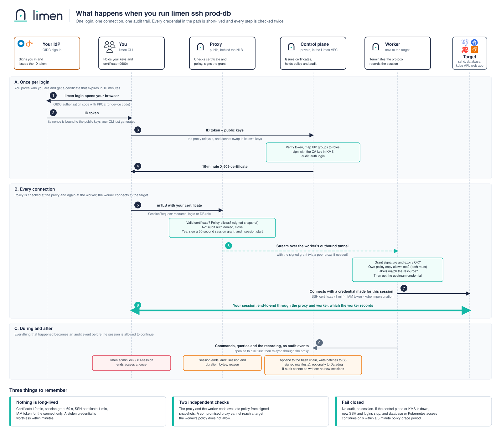
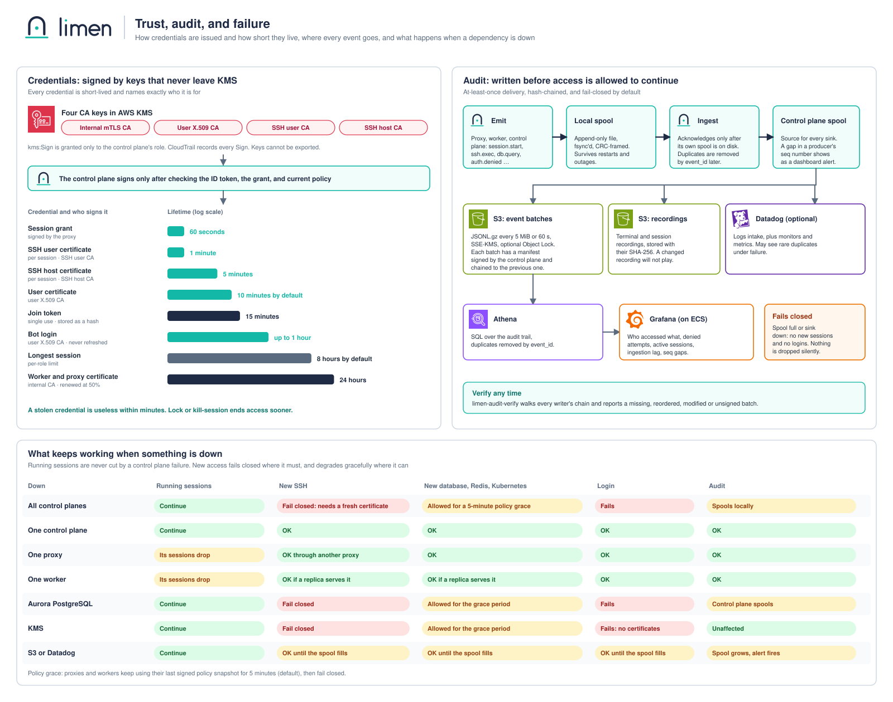

# Diagrams

Three diagrams explain Limen from the top down. Each is a committed [draw.io](https://app.diagrams.net) source plus an exported SVG.

## 1. How Limen works

The big picture on AWS: who connects, the one public entry point, the proxies and control planes in the Limen VPC, the outbound-only workers next to your targets, and where state, keys, and the audit trail live. Numbers 1 to 6 match the captions under the picture.

Source: [`architecture.drawio`](architecture.drawio). Related text: [design §2](../design.md#2-components), [§3](../design.md#3-network-and-ingress-adr-0005), [§6](../design.md#6-reverse-tunnel-and-ha-routing-adr-0003-adr-0004).

## 2. What happens when you run `limen ssh prod-db`

One login and one connection, step by step, with the check each component makes and the credential it uses.

Source: [`connection-flow.drawio`](connection-flow.drawio). Related text: [design §4](../design.md#4-identity-and-credentials-adr-0006-adr-0007) and [§5](../design.md#5-session-flows).

## 3. Trust, audit, and failure

Which keys sign what and how long each credential lives, the path of an audit event from the process that emits it to S3, Datadog, and Grafana, and what keeps working when a dependency is down.

Source: [`trust-and-audit.drawio`](trust-and-audit.drawio). Related text: [design §8](../design.md#8-audit-pipeline-adr-0009), [§9](../design.md#9-failure-semantics-adr-0011), and the [threat model](../threat-model.md).

## Editing

Open the `.drawio` file in diagrams.net (or the VS Code extension), edit, then export as SVG over the matching `.svg` and commit both. For `architecture.svg`, also re-export `architecture.png` (1600 px wide): the repository README shows the PNG because the GitHub mobile app does not draw SVGs that embed images. Keep the diagrams in step with `design.md`: when a flow, TTL, or failure behavior changes there, change it here in the same pull request.

AWS service icons are from the [AWS Architecture Icons](https://aws.amazon.com/architecture/icons/) set. Other logos (Datadog, Grafana, Okta, OpenID, GitHub, GitLab, PostgreSQL, MySQL, Redis, MongoDB, Kubernetes, OpenSearch, Elasticsearch, RabbitMQ, Kafka) are from [Simple Icons](https://simpleicons.org). All are trademarks of their owners, shown only to name the product, and imply no endorsement. A managed-service variant waits until a managed offering is decided.
